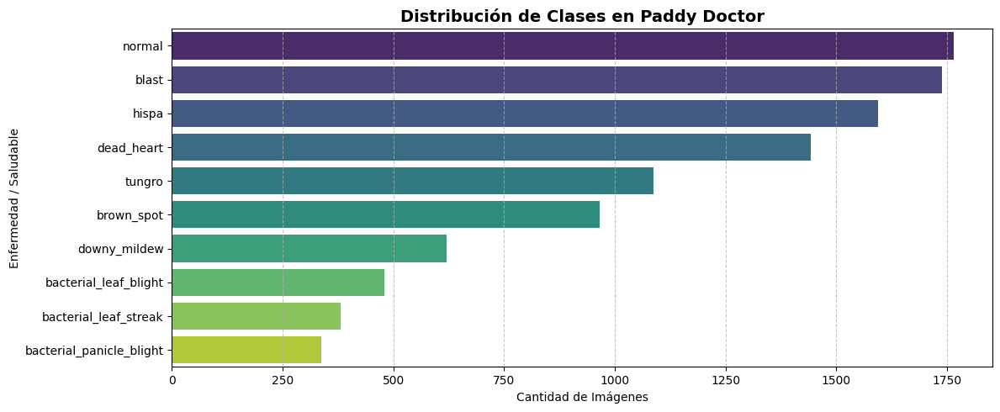
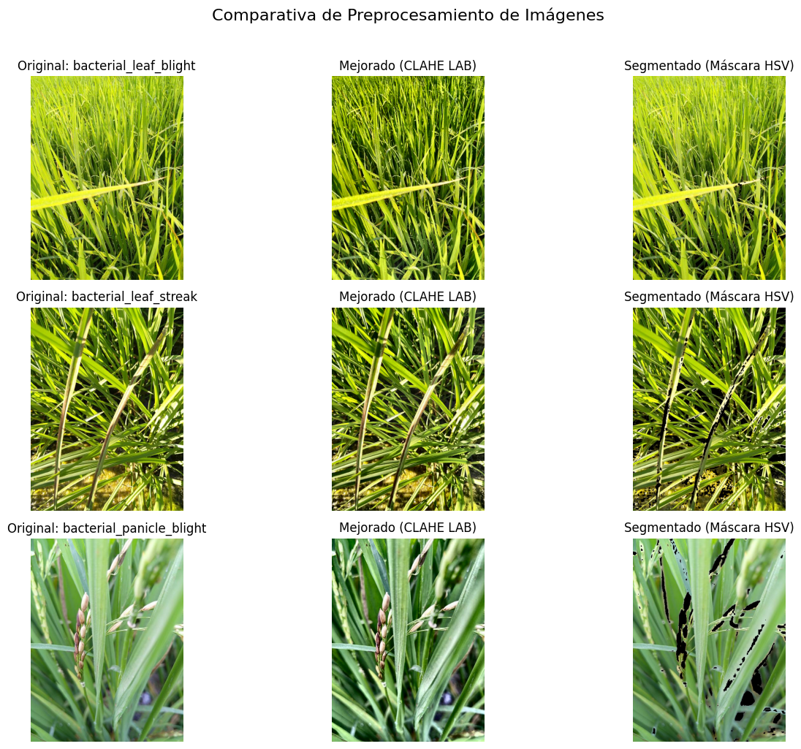

# Preprocesamiento de imágenes del dataset Paddy Doctor

Proyecto semestral — Visión Computacional
Universidad Nacional de San Antonio Abad del Cusco (UNSAAC) · Ingeniería Informática y de Sistemas
Docente: Hans Harley Ccacyahuillca Bejar

**Integrantes:** Andree Achahuanco Valenza · Jose Ramiro Palomino Auquitayasi

## Descripción

Flujo de preprocesamiento de imágenes para clasificar enfermedades del arroz con el dataset
[Paddy Doctor](https://www.kaggle.com/c/paddy-disease-classification) (10 407 imágenes, 10 clases:
9 enfermedades o plagas y 1 clase sana).

## ¿Por qué este dataset?

- Clasificación fina entre 10 clases visualmente parecidas.
- Desbalance de clases (relación aproximada 5,2 : 1).
- Imágenes de campo con iluminación, fondos y encuadres variables.

## Flujo de preprocesamiento

1. Lectura con OpenCV y validación del archivo.
2. CLAHE sobre el canal L del espacio LAB (clipLimit 3,0; mosaico 8×8): mejora el contraste sin alterar el color.
3. Redimensionamiento a 256×256 con `INTER_AREA`.
4. Aumento de datos (Albumentations): giros, rotaciones, ColorJitter y ShiftScaleRotate (solo entrenamiento).
5. Normalización con estadísticos de ImageNet y conversión a tensor de PyTorch.

Se evaluó una máscara HSV para aislar la vegetación, pero se **descartó** porque elimina también las lesiones.




## Estructura del repositorio

```
notebooks/   Cuaderno con el preprocesamiento
docs/        Informe técnico (PDF)
figures/     Figuras del análisis
requirements.txt
```

## Cómo ejecutarlo

1. Crea una cuenta en Kaggle, acepta las reglas de la competencia
   (https://www.kaggle.com/c/paddy-disease-classification/rules) y genera tu propio token de API
   (Settings → API → Create New Token).
2. Abre `notebooks/paddy_doctor_preprocessing.ipynb` en Google Colab con GPU (T4) y sube tu `kaggle.json` cuando se solicite.
3. Ejecuta las celdas en orden. El dataset se descarga automáticamente.

> **Importante:** el dataset y el archivo `kaggle.json` no se incluyen en este repositorio.
> Las imágenes están sujetas a las reglas de la competencia de Kaggle.

## Limitaciones y trabajo futuro

- Falta la partición entrenamiento/validación estratificada.
- El desbalance de clases no se corrige todavía (pesos de clase, muestreo ponderado o pérdida focal).
- CLAHE y el redimensionamiento podrían precalcularse una sola vez.
- Estudio de ablación con y sin CLAHE.
- Migrar `ShiftScaleRotate` a `Affine`.

## Referencias

Detalladas en `docs/informe_preprocesamiento_paddy_doctor.pdf`.
