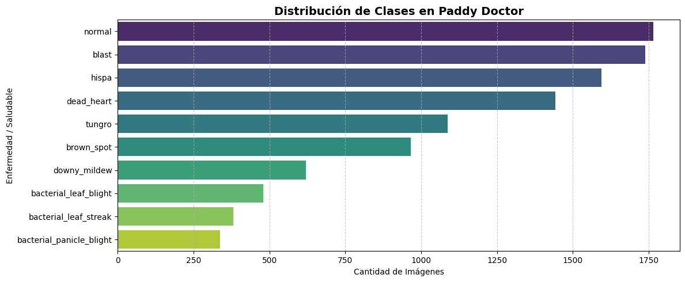
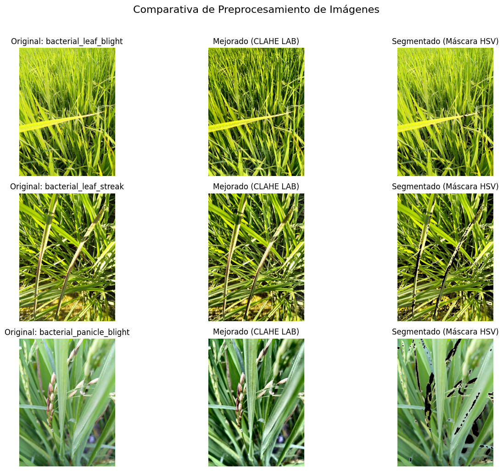

# Paddy Doctor: preprocesamiento y comparación de modelos

Proyecto semestral — Visión Computacional
Universidad Nacional de San Antonio Abad del Cusco (UNSAAC) · Ingeniería Informática y de Sistemas
Docente: Hans Harley Ccacyahuillca Bejar

**Integrantes:** Andree Achahuanco Valenza · Jose Ramiro Palomino Auquitayasi

## Descripción

Proyecto de visión computacional para clasificar enfermedades del arroz con el dataset
[Paddy Doctor](https://www.kaggle.com/c/paddy-disease-classification) (10 407 imágenes, 10 clases:
9 enfermedades o plagas y 1 clase sana). El repositorio incluye un flujo de preprocesamiento y un
benchmark de modelos de clasificación.

## ¿Por qué este dataset?

- Clasificación fina entre 10 clases visualmente parecidas.
- Desbalance de clases (relación aproximada 5,2 : 1).
- Imágenes de campo con iluminación, fondos y encuadres variables.

## Flujo de preprocesamiento

1. Lectura con OpenCV y validación del archivo.
2. CLAHE sobre el canal L del espacio LAB (clipLimit 3,0; mosaico 8×8): mejora el contraste sin alterar el color.
3. Redimensionamiento a 256×256 con `INTER_AREA`.
4. Aumento de datos (Albumentations): giros, rotaciones, ColorJitter y ShiftScaleRotate (solo entrenamiento).
5. Normalización con estadísticos de ImageNet y conversión a tensor de PyTorch.

Se evaluó una máscara HSV para aislar la vegetación, pero se **descartó** porque elimina también las lesiones.

## Benchmark de clasificación

El notebook `notebooks/paddy_doctor_model_comparison.ipynb` compara cuatro modelos con la misma
partición estratificada 80/10/10 (semilla 42):

- ResNet34
- EfficientNet-B0
- ViT-Small/16
- Híbrido EfficientNet-B0 + ViT-Small/16

Aplica aumentos solo al conjunto de entrenamiento, usa pesos por clase, selecciona checkpoints por
F1 macro de validación y reporta accuracy, balanced accuracy, F1 macro/ponderado, matrices de
confusión y métricas por clase. Se recomienda una GPU; la precisión mixta se activa cuando CUDA está
disponible.

Los informes y diapositivas editables están en `docs/`. Las cifras de artículos allí identificadas
como referencias son resultados publicados por sus autores, no resultados del benchmark local.
Sustituye o completa las tablas de resultados propios cuando finalicen las cuatro ejecuciones y la
evaluación de test.




## Estructura del repositorio

```
notebooks/   Cuadernos de preprocesamiento y benchmark
docs/        Informe técnico y materiales LaTeX
figures/     Figuras del análisis
requirements.txt
.gitignore
```

## Cómo ejecutarlo

1. Crea una cuenta en Kaggle, acepta las reglas de la competencia
   (https://www.kaggle.com/c/paddy-disease-classification/rules) y genera tu propio token de API
   (Settings → API → Create New Token).
2. Abre `notebooks/paddy_doctor_preprocessing.ipynb` en Google Colab con GPU (T4) y sube tu `kaggle.json` cuando se solicite.
3. Ejecuta las celdas en orden. El dataset se descarga automáticamente en `./paddy_data`.
4. En el mismo entorno, abre `notebooks/paddy_doctor_model_comparison.ipynb`. Comprueba que
   `./paddy_data/train.csv` y `./paddy_data/train_images` existan, y ejecuta las celdas en orden.
   El benchmark está activado por defecto; la primera celda informa si se detectó CUDA.
   Los checkpoints y resultados se guardan en `./paddy_model_comparison`.

> **Importante:** el dataset y el archivo `kaggle.json` no se incluyen en este repositorio.
> Las imágenes están sujetas a las reglas de la competencia de Kaggle.

## Limitaciones y trabajo futuro

- El notebook de preprocesamiento no realiza una evaluación comparativa de modelos.
- El benchmark usa una única partición estratificada; falta evaluar variabilidad entre semillas y datos externos.
- CLAHE y el redimensionamiento podrían precalcularse una sola vez.
- Estudio de ablación con y sin CLAHE.
- Migrar `ShiftScaleRotate` a `Affine`.

## Referencias

Detalladas en `docs/informe_preprocesamiento_paddy_doctor.pdf`.
